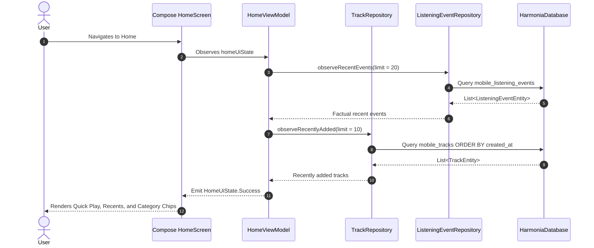
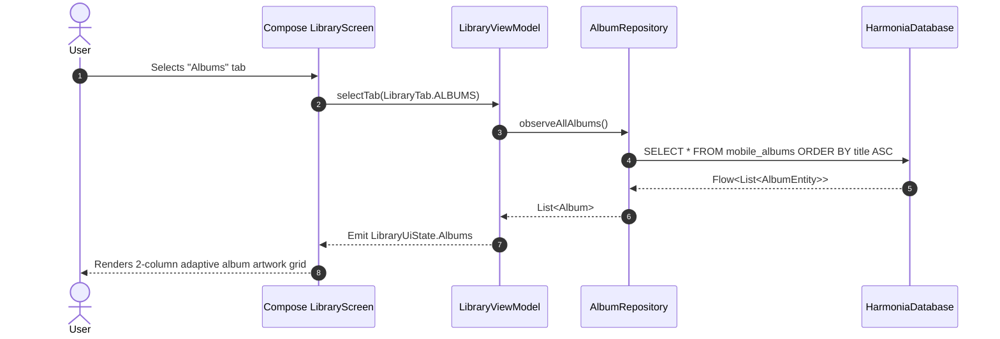
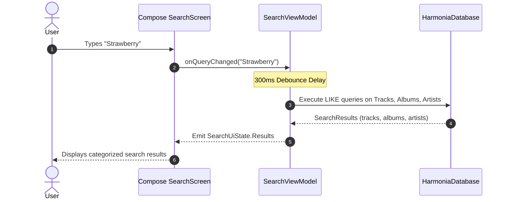
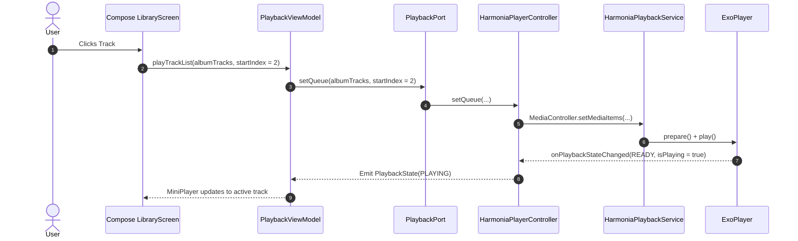
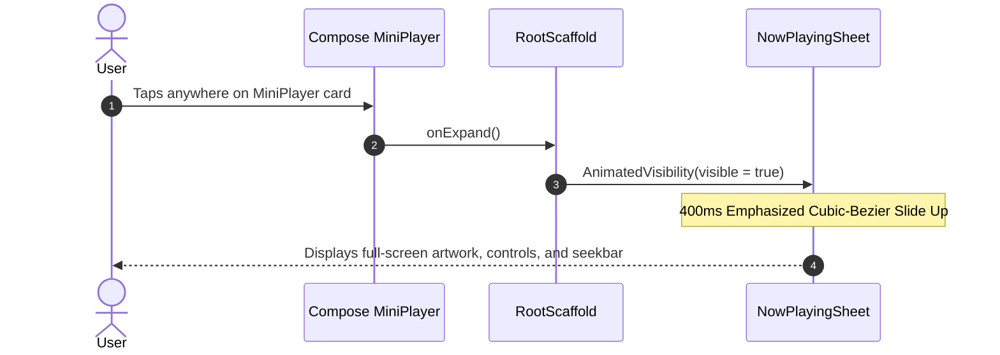
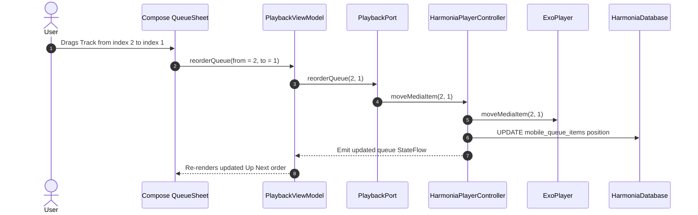
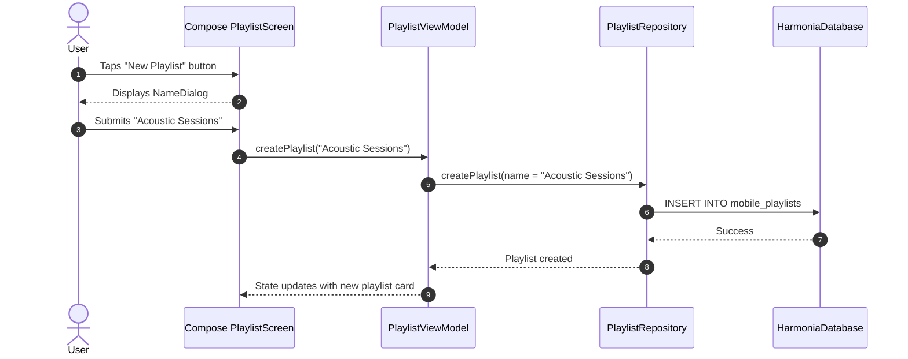
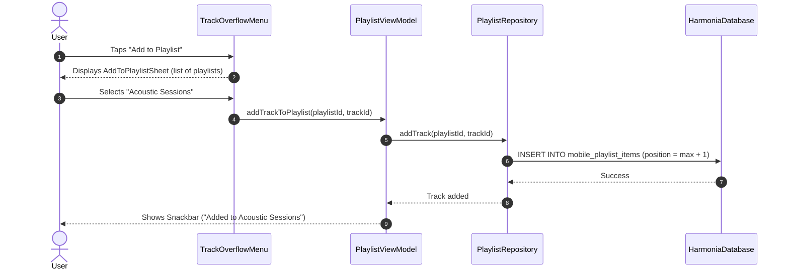
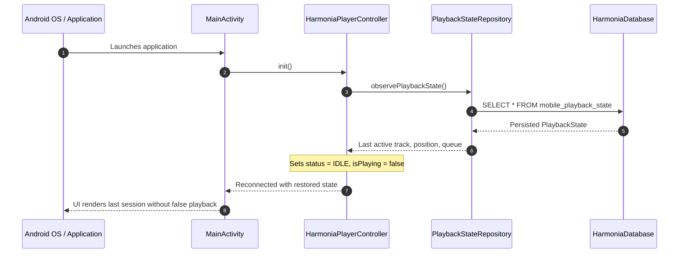

# Harmonia Mobile Phase M3: Architecture & UI/UX Specification

## 1. Baseline & Executive Scope Freeze

### 1.1 Authoritative Baseline
Phase M3 strictly builds upon the verified native foundation and playback engine:
- **Phase M0**: Android-first native architecture (`7ec4f77`).
- **Phase M1**: Native Android foundation, Room schema v1, Compose theme (`34a5f79`).
- **Phase M2**: Native Media3 playback engine, foreground `MediaSessionService`, audio-enabled verification on AVD (`3578e58`, tag `restore-point/mobile-m2-complete`).

### 1.2 In-Scope for Phase M3
Phase M3 transforms the verified playback engine into a complete, responsive, offline Android music player UI:
1. **Navigation**: 5-destination bottom navigation bar (**Home**, **Library**, **Playlists**, **Search**, **Settings**) with type-safe Jetpack Navigation Compose.
2. **Home Screen**:
   - Quick Play actions ("Shuffle All", "Resume").
   - "Recently Played" horizontal carousel (derived from factual `ListeningEvent` history).
   - "Recently Added" horizontal carousel (newest library items).
   - Category shortcuts (Artists, Albums, Playlists).
   - Contextual empty states for unpopulated libraries.
3. **Library Screen**:
   - Tabbed browsing: **Tracks**, **Albums**, **Artists**.
   - Sort ordering: Title (A-Z, Z-A), Artist, Date Added, Duration.
   - Album grid with square artwork cards.
   - Artist list with circular avatars and track/album count badges.
   - Track list with index, duration, and overflow action sheet.
4. **Now Playing Experience**:
   - Dominant square artwork presentation with subtle rounded corners.
   - Marquee text scrolling for lengthy titles and artist names.
   - Real-time scrubbable seek slider with elapsed and remaining timestamps.
   - Complete transport controls: Shuffle toggle, Previous, Large Play/Pause, Next, Repeat mode toggle.
   - Auxiliary action drawer toggles: Up Next Queue sheet, Technical Audio Details sheet.
5. **Persistent Mini Player**:
   - Docked 64dp card positioned above the bottom navigation bar.
   - Thumbnail artwork (48dp), title, artist, play/pause toggle, skip next.
   - Top 2dp progress indicator displaying playback fraction.
   - Fluid slide-up expansion into the full Now Playing canvas.
6. **Authoritative Queue Management**:
   - Up Next list displaying upcoming tracks.
   - Interactive reordering (drag-to-reorder) and item removal (swipe-to-remove).
   - "Clear Queue" and "Save Queue as Playlist" operations.
   - Strict synchronization with the underlying Media3 `Timeline`.
7. **Local Playlists**:
   - Playlist creation with name validation dialog.
   - "Add to Playlist" action accessible from all track overflow menus.
   - Playlist detail view with drag-and-drop item reordering.
   - Playlist rename and deletion.
   - Deterministic integer position indexing.
8. **Local Search**:
   - Real-time debounced ($300\text{ms}$) search across Tracks, Albums, Artists, and Playlists.
   - Grouped result categorization.
   - Recent search query chips and empty search prompt.

### 1.3 Strict Out-of-Scope Exclusions (Forbidden in M3)
To prevent scope creep and maintain architectural integrity, the following capabilities are strictly forbidden in Phase M3 and deferred to future milestones:
- ❌ **Harmonia AI & Recommendation Engines**: No mood analysis, taste profiling, or smart playlist generation.
- ❌ **Cloud & Remote Sync**: No mDNS discovery, QR pairing, remote library sync, or Jellyfin streaming (deferred to Phase M4).
- ❌ **Automotive Integration**: No Android Auto / Automotive OS MediaLibraryService roots (deferred to Phase M5).
- ❌ **Cross-Platform / Multiplatform**: Zero Kotlin Multiplatform (KMP), Compose Multiplatform (CMP), SQLDelight, or iOS implementations.
- ❌ **Advanced DSP & Visualizers**: No 31-band graphic equalizers, ReplayGain volume matching, or audio-reactive visualizers (deferred to Phase M6).
- ❌ **Telemetry & Analytics**: Zero external analytics SDKs, trackers, or cloud event loggers.

---

## 2. Layered System Architecture & Boundary Rules

### 2.1 Tiered Component Stack
```
                 ┌────────────────────────────────────────┐
                 │          Jetpack Compose UI            │
                 │   (Home, Library, NowPlaying, Queue)   │
                 └───────────────────┬────────────────────┘
                                     │ User Intents / Flow Observation
                                     ▼
                 ┌────────────────────────────────────────┐
                 │           ViewModel Layer              │
                 │  (PlaybackVM, LibraryVM, PlaylistVM)   │
                 └───────────────────┬────────────────────┘
                                     │ Domain Interfaces
                                     ▼
                 ┌────────────────────────────────────────┐
                 │             Domain Layer               │
                 │  (PlaybackPort, Repositories, Entities)│
                 └───────────┬────────────────┬───────────┘
                             │                │
            Media Commands   │                │ Data Persistence
                             ▼                ▼
┌──────────────────────────────────────┐  ┌──────────────────────────────────────┐
│        HarmoniaPlayerController      │  │        Offline Repositories          │
│          (MediaController)           │  │     (Track, Playlist, Event Repo)    │
└──────────────────┬───────────────────┘  └──────────────────┬───────────────────┘
                   │ IPC / SessionToken                      │ Room SQLite
                   ▼                                         ▼
┌──────────────────────────────────────┐  ┌──────────────────────────────────────┐
│       HarmoniaPlaybackService        │  │           HarmoniaDatabase           │
│        (MediaSessionService)         │  │         (Room SQLite WAL Mode)       │
└──────────────────┬───────────────────┘  └──────────────────────────────────────┘
                   │
                   ▼
┌──────────────────────────────────────┐
│         ExoPlayer Engine             │
│        (AudioTrack / HAL)            │
└──────────────────────────────────────┘
```

### 2.2 Boundary Invariants
1. **Zero Framework In Domain**: The `org.harmonia.player.domain.*` package must not import any `android.*`, `androidx.*`, `ExoPlayer`, `MediaItem`, or `Room` classes.
2. **UI Never Accesses DAOs Directly**: Compose screens must interact exclusively with ViewModels; ViewModels interact strictly with domain repositories and `PlaybackPort`.
3. **UI Never Calculates Queue Indices**: The presentation layer never calculates `currentIndex + 1` or `currentIndex - 1`. All queue progression is requested via `PlaybackPort.next()`, `PlaybackPort.previous()`, or `PlaybackPort.jumpToQueueIndex()`.
4. **Playback Remains Owned by M2 Engine**: All audio decoding, MediaSession notification handling, and audio focus management remain inside `HarmoniaPlaybackService`. M3 adds pure presentation and playlist management.

---

## 3. Navigation & Screen Architecture

### 3.1 Route Hierarchy
Using Jetpack Navigation Compose with Kotlin Serialization:

```kotlin
@Serializable sealed interface HarmoniaRoute {
    @Serializable data object Home : HarmoniaRoute
    @Serializable data object Library : HarmoniaRoute
    @Serializable data object Playlists : HarmoniaRoute
    @Serializable data object Search : HarmoniaRoute
    @Serializable data object Settings : HarmoniaRoute

    // Detail Routes
    @Serializable data class AlbumDetail(val albumId: String) : HarmoniaRoute
    @Serializable data class ArtistDetail(val artistId: String) : HarmoniaRoute
    @Serializable data class PlaylistDetail(val playlistId: String) : HarmoniaRoute
}
```

### 3.2 RootScaffold & Overlay Composition
The root application layout utilizes a layered `Box` layout:
1. **Primary Layer**: `Scaffold` containing the active `NavHost` and the bottom `NavigationBar` with 5 navigation items.
2. **Docked Mini Player**: Positioned directly above the bottom navigation bar (`Alignment.BottomCenter`).
3. **Modal Overlay Layer**: `AnimatedVisibility` expanding the full-screen `NowPlayingSheet` upward over the entire screen when triggered, intercepting back button presses via `BackHandler`.

---

## 4. Database Impact & Room Schema Evolution

### 4.1 Schema Evolution: Version 1 $\to$ Version 2
To support local user playlists in Phase M3 without altering existing library tables, the Room database version increases from `1` to `2`.

### 4.2 New Entities

#### `PlaylistEntity`
```kotlin
@Entity(tableName = "mobile_playlists")
data class PlaylistEntity(
    @PrimaryKey
    val id: String,
    val name: String,
    val description: String? = null,
    @ColumnInfo(name = "artwork_hash")
    val artworkHash: String? = null,
    @ColumnInfo(name = "created_at")
    val createdAt: Long,
    @ColumnInfo(name = "updated_at")
    val updatedAt: Long
)
```

#### `PlaylistItemEntity`
```kotlin
@Entity(
    tableName = "mobile_playlist_items",
    foreignKeys = [
        ForeignKey(
            entity = PlaylistEntity::class,
            parentColumns = ["id"],
            childColumns = ["playlist_id"],
            onDelete = ForeignKey.CASCADE
        ),
        ForeignKey(
            entity = TrackEntity::class,
            parentColumns = ["id"],
            childColumns = ["track_id"],
            onDelete = ForeignKey.CASCADE
        )
    ],
    indices = [
        Index(value = ["playlist_id"]),
        Index(value = ["track_id"]),
        Index(value = ["playlist_id", "position"], unique = true)
    ]
)
data class PlaylistItemEntity(
    @PrimaryKey
    val id: String,
    @ColumnInfo(name = "playlist_id")
    val playlistId: String,
    @ColumnInfo(name = "track_id")
    val trackId: String,
    val position: Int,
    @ColumnInfo(name = "added_at")
    val addedAt: Long
)
```

### 4.3 New DAO: `PlaylistDao`
```kotlin
@Dao
interface PlaylistDao {
    @Query("SELECT * FROM mobile_playlists ORDER BY updated_at DESC")
    fun observeAllPlaylists(): Flow<List<PlaylistEntity>>

    @Query("SELECT * FROM mobile_playlists WHERE id = :playlistId")
    suspend fun getPlaylistById(playlistId: String): PlaylistEntity?

    @Insert(onConflict = OnConflictStrategy.REPLACE)
    suspend fun insertPlaylist(playlist: PlaylistEntity)

    @Update
    suspend fun updatePlaylist(playlist: PlaylistEntity)

    @Query("DELETE FROM mobile_playlists WHERE id = :playlistId")
    suspend fun deletePlaylist(playlistId: String)

    @Query("""
        SELECT i.* FROM mobile_playlist_items i 
        WHERE i.playlist_id = :playlistId 
        ORDER BY i.position ASC
    """)
    fun observePlaylistItems(playlistId: String): Flow<List<PlaylistItemEntity>>

    @Insert(onConflict = OnConflictStrategy.REPLACE)
    suspend fun insertItem(item: PlaylistItemEntity)

    @Insert(onConflict = OnConflictStrategy.REPLACE)
    suspend fun insertItems(items: List<PlaylistItemEntity>)

    @Query("DELETE FROM mobile_playlist_items WHERE playlist_id = :playlistId AND track_id = :trackId")
    suspend fun removeItem(playlistId: String, trackId: String)

    @Query("DELETE FROM mobile_playlist_items WHERE playlist_id = :playlistId")
    suspend fun clearPlaylist(playlistId: String)
}
```

### 4.4 Migration Strategy
A deterministic `Migration(1, 2)` script will execute the `CREATE TABLE` and `CREATE INDEX` statements, maintaining Write-Ahead Logging (WAL) integrity.

---

## 5. Queue UX Architecture & Deterministic Operations

### 5.1 Dual-Layer Queue Model
Harmonia enforces an unambiguous queue model:
1. **Currently Playing**: Active track highlighted with distinct playback accent indicator.
2. **Layer 1: Up Next (Explicit User Queue)**: Tracks added explicitly via "Play Next" or "Add to Queue". Formats a strict FIFO structure.
3. **Layer 2: Context Queue**: Ambient album, playlist, or library context initiated when playback began.

### 5.2 Deterministic Queue Actions (`PlaybackPort`)
- `reorderQueue(fromPosition: Int, toPosition: Int)`: Updates queue item ordering in Media3 and Room.
- `removeFromQueue(position: Int)`: Removes the specified item without interrupting active playback.
- `clearQueue()`: Removes all future upcoming tracks while allowing the active track to continue playing.
- `playQueueItem(position: Int)`: Jumps playback directly to the specified queue index.
- `saveQueueAsPlaylist(name: String)`: Persists the active queue as a new user playlist.

---

## 6. Artwork Architecture & Visual Asset Strategy

### 6.1 Identity & Caching
1. **Canonical Identity**: Artwork is identified exclusively by its SHA-256 hash (`artwork_hash`), matching Harmonia Core desktop conventions.
2. **On-Disk Cache**: Stored in `context.filesDir/artwork/{artwork_hash}.jpg`.
3. **Coil Image Loading**: Coil is configured with disk and memory caches. Crossfades between placeholders and loaded bitstreams over $200\text{ms}$.
4. **Deterministic Fallback**: When `artwork_hash` is null or the file is missing, an algorithmic gradient background based on `ObsidianSpace` and `AcousticTeal` is rendered with a central musical glyph.

---

## 7. Performance & Memory Optimization

1. **Lazy List Item Keys**: Every `LazyColumn` and `LazyVerticalGrid` must supply a deterministic, unique key:
   ```kotlin
   items(tracks, key = { it.id }) { track -> TrackItemRow(track = track) }
   ```
2. **Recomposition Containment**: UI state classes are annotated with `@Immutable`. Expensive computed values (e.g., formatted timestamps, duration totals) are computed via `remember(key)`.
3. **Room Reactive Streams**: Queries use `Flow` with `distinctUntilChanged()` to avoid emitting redundant snapshots when unrelated tables change.
4. **Fast Scrolling**: Alphabetical jumping utilizes `LazyListState.scrollToItem()` without loading unviewed artwork into memory.

---

## 8. Accessibility & Ergonomics Standards

1. **Touch Targets**: All interactive elements (play buttons, overflow menus, sliders, tab items) have a minimum clickable area of $48\text{dp} \times 48\text{dp}$.
2. **Contrast Standards**: All text satisfies WCAG 2.1 AA ($4.5:1$ contrast ratio minimum against background surfaces):
   - Primary Text: `PureSignalWhite` (`#FFFFFF`) on `ObsidianSpace` (`#0D0E11`): Contrast $\approx 18.5:1$.
   - Secondary Text: `MutedSlate` (`#8E929B`) on `AcousticCharcoal` (`#16181D`): Contrast $\approx 5.2:1$.
3. **Screen Readers (TalkBack)**: All icon buttons and state indicators supply concise, descriptive `contentDescription` attributes (e.g., "Play", "Pause", "Next track", "Track options for {title}").

---

## 9. M3 Data Flow Diagrams

### Flow A: Open Home Screen


### Flow B: Open Library (Albums View)


### Flow C: Search Query


### Flow D: Start Playback from Library


### Flow E: Expand Now Playing Sheet


### Flow F: Modify Queue (Reorder Up Next)


### Flow G: Create Playlist


### Flow H: Add Track to Playlist


### Flow I: Cold Start Recovery


---

## 10. Objective M3 Acceptance Criteria & Test Plan

Every Phase M3 feature must be verified against objective, deterministic criteria across five testing tiers:

### Tier 1: JVM Unit Tests (`gradlew.bat test`)
1. **Navigation Routing**: Assert all route arguments serialize and deserialize without loss.
2. **Queue Reordering**: Unit tests verifying that moving queue items correctly adjusts indices and maintains the active playing track pointer.
3. **Auxio-Style "Play Next" Insertion**: Unit test verifying that adding a track to "Play Next" places it contiguously at `activeQueueIndex + 1`.
4. **Playlist Item Ordering**: Assert that deleting an item from the middle of a playlist updates the `position` of subsequent items without gaps.
5. **Search Query Filtering**: Assert debounced local search filters tracks, albums, and artists case-insensitively and returns expected matches.

### Tier 2: Room SQLite Integration Tests
1. **Playlist Table Creation**: Verify migration from schema v1 to schema v2 creates `mobile_playlists` and `mobile_playlist_items` tables.
2. **Cascade Deletion**: Verify that deleting a playlist cascades and removes its child items from `mobile_playlist_items`.
3. **Unique Position Constraint**: Assert that attempting to insert duplicate `(playlist_id, position)` raises an `SQLiteConstraintException`.
4. **FTS / Search Query Performance**: Verify search queries complete within $50\text{ms}$ on a simulated 5,000-item database.

### Tier 3: Compose UI Tests (`androidTest`)
1. **Bottom Navigation**: Verify clicking each navigation tab switches the visible screen and highlights the active icon.
2. **Mini Player Docking**: Verify Mini Player is visible when a track is active and hidden when state is uninitialized.
3. **Now Playing Expansion**: Verify clicking the Mini Player expands the `NowPlayingSheet` overlay and intercepts the system Back button.
4. **Touch Target Dimensions**: Assert all clickable icons have a minimum bounding box of $48\text{dp} \times 48\text{dp}$.

### Tier 4: Connected Android Tests on AVD (`gradlew.bat connectedAndroidTest`)
1. **Full Playback Flow from Library**: Click track in Library $\to$ verify playback starts $\to$ verify Mini Player updates $\to$ verify notification appears.
2. **Queue Reordering during Playback**: Reorder upcoming track in Up Next queue $\to$ verify playback of current track is uninterrupted $\to$ verify next track matches new order.
3. **Playlist Creation & Playback**: Create playlist $\to$ add 2 tracks $\to$ play playlist $\to$ verify queue matches playlist items in exact order.

### Tier 5: Manual Visual Verification Checklist
1. **Theme Fidelity**: Consistent use of `ObsidianSpace` (`#0D0E11`), `AcousticCharcoal` (`#16181D`), and `AcousticTeal` (`#26D0CE`).
2. **Typography Hierarchy**: Distinct header, body, and caption styling using high-contrast typography.
3. **Artwork Graceful Degradation**: Confirm missing artwork displays the branded geometric waveform gradient.
4. **Gesture Smoothness**: Confirm 60fps sheet expansion motion without frame drops on the AVD emulator.
