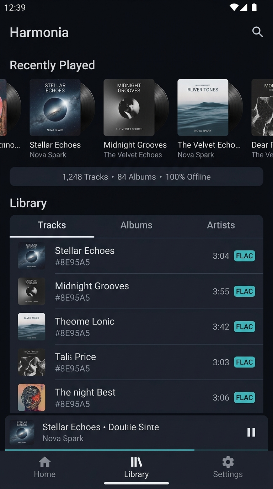

# Harmonia Mobile — Concept A: Home & Library Experience (Stage 5C)

**Document Classification:** Visual Design Concept & Specification  
**Status:** DRAFT CONCEPT FOR REVIEW (Stage 5C)  
**Target Platform:** Android 14+ (Jetpack Compose, Material 3, Dark-First Baseline)  
**Target Form Factor:** Compact Mobile (390dp × 844dp to 412dp × 915dp, 9:16 / 19.5:9 aspect ratio)  

---

## 1. Visual Presentation & Concept Artifact

*Visual Render Description:* Concept A establishes the primary entry and catalog browsing experience for Harmonia Mobile. Set against the `ObsidianSpace` (`#090B10`) background, the layout avoids decorative clutter, presenting an elevated physical hierarchy of local audio content.

---

## 2. Visual Hierarchy & Spatial Layout

Concept A balances top-level dashboard metrics with deep local catalog navigation:

1. **Top Application Bar (48dp height):**
   - Brand title `Harmonia` in `displayLarge` (28sp bold, `#F0F3F8`).
   - Direct search entry icon button (48dp touch target) on the right, providing instantaneous entry into local catalog filtering.

2. **Recently Played Carousel (180dp height):**
   - Section header `Recently Played` in `titleLarge` (18sp semi-bold).
   - Horizontal snap list of recent vinyl/album cards (120dp × 120dp) with sharp 12dp rounded corners and subtle vinyl groove texture.
   - Secondary metadata: Track title (`titleMedium`, 16sp, `#F0F3F8`) and Artist name (`bodyMedium`, 13sp, `#8E95A5`).
   - Backed directly by verified listening events. *(Note: All artist names, track titles, and album covers shown in mockups are illustrative sample data).*

3. **Local Library Integrity Banner (36dp height):**
   - Dark container (`#141721`) with 1dp hairline border (`#2A3042`).
   - Summary telemetry: `1,248 Tracks • 84 Albums • 100% Offline`.
   - Replaces vague cloud banners with factual, sovereign offline data. *(Note: Numerical counts and '100% Offline' are illustrative sample mockups; the runtime UI binds dynamically to Room query results).*

4. **Segmented Library Navigation Tabs (48dp height):**
   - Top-level segmented pill tabs: `Tracks`, `Albums`, `Artists`.
   - Selected tab indicated by bright cyan-teal underline indicator (`#00D2B4`) and full-opacity white text.

5. **Track Catalog List Items (64dp item height):**
   - Elevated list card (`#141721`) with 1dp structural boundary (`#2A3042`).
   - 48dp × 48dp album artwork thumbnail with 6dp corner radius.
   - Track title in `titleMedium` (16sp, `#F0F3F8`), Artist in `bodyMedium` (13sp, `#8E95A5`).
   - Audio technical format badge: `FLAC` in cyan-teal pill badge (`#00D2B4` border, 10sp bold uppercase).
   - Tabular monospace duration (`3:04`, `#8E95A5`).

6. **Persistent Mini-Player Bar (64dp height):**
   - Positioned directly above the bottom navigation bar.
   - High-contrast 40dp square artwork, track title, artist name, and 48dp play/pause button.
   - Micro-progress hairline (2dp) across the top edge displaying playback progress in cyan-teal (`#00D2B4`).

7. **Primary Navigation Bar (64dp height):**
   - 3 core tabs: `Home`, `Library`, `Settings`.
   - High-contrast icons with 48dp minimum touch bounds.

---

## 3. Component Taxonomy & Responsibilities

| Component | Responsibility | Visual Tokens | Source Verification |
| :--- | :--- | :--- | :--- |
| `HomeTopBar` | Brand identity and search access | `colorBackgroundRoot`, `colorTextPrimary` | `[VERIFIED-SRC]` (`HomeScreen.kt`) |
| `RecentlyPlayedRow` | Rapid access to recent playback sessions | `colorSurfaceElevated`, `colorTextPrimary` | `[VERIFIED-SRC]` (`ListeningEventRepository`) |
| `LibraryMetricsBadge` | Offline library status & count | `colorSurfaceContainer`, `colorPrimarySignal` | `[VERIFIED-SRC]` (`TrackDao`, `AlbumDao`) |
| `LibraryTabRow` | Switching catalog views (Tracks/Albums/Artists) | `colorSurfaceContainer`, `colorPrimarySignal` | `[VERIFIED-SRC]` (`LibraryScreen.kt`) |
| `TrackListItem` | Individual track row with playback trigger | `colorSurfaceElevated`, `colorBorderStructural` | `[VERIFIED-SRC]` (`TrackItem.kt`) |
| `TechnicalFormatBadge` | Displays lossless/lossy format tag (e.g. FLAC, MP3) | `colorPrimarySignal`, 10sp bold | `[VERIFIED-SRC]` (`LocalFileEntity.format`) |
| `MiniPlayerBar` | Persistent playback control and Now Playing launch | `colorSurfaceElevated`, `colorPrimarySignal` | `[VERIFIED-SRC]` (`MiniPlayer.kt`) |
| `BottomNavBar` | Top-level destination switching | `colorSurfaceElevated`, `colorBorderStructural` | `[VERIFIED-SRC]` (`MainActivity.kt`) |

---

## 4. Navigation & State Behaviors

- **Tap on Track Row:** Immediately queues and plays track; updates `MiniPlayerBar`; highlights active track row with teal accent.
- **Tap on Mini-Player:** Expands `NowPlayingSheet` modal upwards.
- **Tap on Search Icon:** Switches to `SearchScreen` with immediate keyboard focus.
- **Fast Scrolling:** As list exceeds 100 items, `FastScrollRail` indicator appears on the right margin with alphabetic popover.

---

## 5. Accessibility & Error States

- **Contrast Validation:** Primary text (`#F0F3F8`) on elevated card (`#141721`) achieves **14.82:1** (WCAG AAA). Format badge cyan-teal (`#00D2B4`) on `#141721` achieves **8.53:1** (WCAG AAA).
- **Touch Targets:** All interactive icons, tabs, and track items strictly satisfy $\ge$ 48dp $\times$ 48dp bounds.
- **200% Font Scaling:** Track title and artist are wrapped in flexible column layout with `TextOverflow.Ellipsis`; minimum row height flexes from 64dp up to 88dp dynamically.
- **Empty State (No Tracks):** Displays a calm empty state: *"No local audio files indexed. Ensure music is stored in indexed storage folders."* with a direct action button: `Open Storage Settings`.

---

## 6. Implementation Mapping: Verified vs Proposed

- **Verified Existing Elements (`[VERIFIED-SRC]`):**
  - Library track list, album grid, and artist list backed by Room.
  - Recently Played querying from `ListeningEventRepository`.
  - Metrics computation (`TrackDao.count()`, `AlbumDao.count()`).
  - Persistent Mini-Player playback state from `PlaybackViewModel`.
- **Proposed Refinements (`[PROPOSED]`):**
  - Formalizing the 1dp `colorBorderStructural` hairline border across all cards.
  - Adding the explicit `FLAC` / format chip to catalog track list items.
  - Upgrading the library metrics bar from plain text to a structured status badge.
