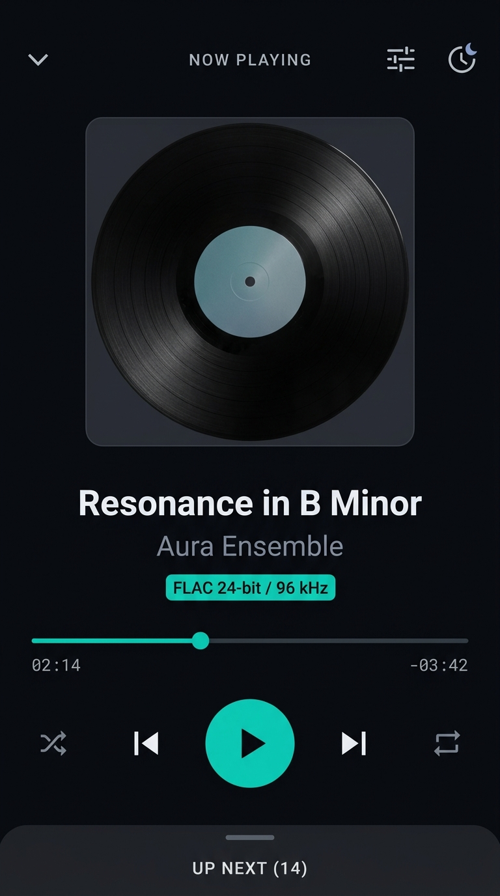

# Harmonia Mobile — Concept B: Now Playing, Mini-Player & Queue (Stage 5C)

**Document Classification:** Visual Design Concept & Specification  
**Status:** DRAFT CONCEPT FOR REVIEW (Stage 5C)  
**Target Platform:** Android 14+ (Jetpack Compose, AndroidX Media3, Material 3)  
**Target Form Factor:** Compact Mobile (390dp × 844dp to 412dp × 915dp, 9:16 / 19.5:9 aspect ratio)  

---

## 1. Visual Presentation & Concept Artifact

*Visual Render Description:* Concept B illustrates the full Now Playing experience. Centered around a commanding vinyl-styled album artwork presentation, the interface brings immediate tactile clarity to transport controls, scrub navigation, technical audio metadata, and queue entry.

---

## 2. Visual Hierarchy & Spatial Layout

Concept B organizes the playback surface into distinct ergonomic zones optimized for one-handed operation:

1. **Top Dismiss & Quick Utility Bar (48dp height):**
   - Left: Down-chevron dismiss button (48dp touch target) collapsing sheet to Mini-Player.
   - Center: `NOW PLAYING` uppercase header tracking (10sp bold, `#8E95A5`).
   - Right: Quick-access utility icons:
     - Equalizer button (slider icon) opening the Equalizer bottom sheet.
     - Sleep Timer button (crescent moon icon) displaying active timer badge if engaged.

2. **Album Artwork Stage (approx 300dp × 300dp):**
   - Centered square artwork frame with 12dp rounded corners and subtle vinyl record texture.
   - Sizing rule: `fillMaxWidth(0.85f)`, constrained to a maximum of 320dp to guarantee zero vertical clipping on compact viewports and under 200% font scaling.
   - Deep structural elevation (`#141721`) with 1dp border (`#2A3042`).

3. **Track Metadata & Audio Inspector Chip (60dp height):**
   - Track Title: `headlineMedium` (22sp semi-bold, `#F0F3F8`, 1 line, marquee if overflowing). *(Illustrative sample: 'Resonance in B Minor')*.
   - Artist Name: `bodyMedium` (14sp normal, `#8E95A5`, 1 line). *(Illustrative sample: 'Aura Ensemble')*.
   - Technical Audio Chip: Cyan-teal pill button (`#00D2B4` border and text, 11sp bold) displaying `FLAC 24-bit / 96 kHz` *(Illustrative sample metadata)*. Tapping triggers the **Audio Signal Inspector** modal sheet.
   > [!IMPORTANT]
   > **Metadata vs Decoded Audio Distinction:** The format chip on Now Playing reflects static container file metadata extracted during media indexing (`LocalFileEntity`). It does **not** prove that the decoded stream or hardware output is operating at 24-bit / 96 kHz or bit-perfect; actual stream and routing details are displayed strictly inside the Audio Signal Inspector modal sheet.

4. **Scrub Navigation & Timecodes (40dp height):**
   - Precision horizontal seek slider with cyan-teal active fill (`#00D2B4`) and 12dp tactile thumb.
   - Flanking timecodes in monospace tabular font:
     - Left: Elapsed time (`02:14`, `#8E95A5`). *(Illustrative sample)*.
     - Right: Remaining time (`-03:42`, `#8E95A5`). *(Illustrative sample)*.

5. **Primary Transport & Playback Controls (80dp height):**
   - Centered Play/Pause Button: 64dp × 64dp circular surface (`#00D2B4` fill, white icon), providing dominant focal point.
   - Flanking Skip Controls: Previous Track and Next Track (48dp touch bounds, 28dp icons, `#F0F3F8`).
   - Outer Mode Controls:
     - Shuffle Toggle (48dp touch bounds): Active = `#00D2B4` with dot; Inactive = `#565E70`.
     - Repeat Toggle (48dp touch bounds): 3-state cycling (Off / Repeat All / Repeat One with '1' badge).

6. **Queue Drawer Entry / Bottom Peek Handle (48dp height):**
   - Upward peek indicator labeled `UP NEXT (14)` with subtle drag handle.
   - Dragging or tapping expands the **Authoritative Queue** overlay.

---

## 3. Component Taxonomy & Responsibilities

| Component | Responsibility | Visual Tokens | Source Verification |
| :--- | :--- | :--- | :--- |
| `DismissChevron` | Collapses Now Playing to Mini-Player | 48dp target, `#F0F3F8` | `[VERIFIED-SRC]` (`NowPlayingSheet.kt`) |
| `NowPlayingArtwork` | Uncropped album cover presentation | 12dp radius, max 320dp | `[VERIFIED-SRC]` (`NowPlayingSheet.kt`) |
| `AudioSignalChip` | Displays verified file format/rate | `colorPrimarySignal`, 11sp | `[PROPOSED]` (`SCREEN_SPECIFICATIONS.md` §9.2) |
| `SeekSlider` | Tactile scrub bar and scrub preview | `colorPrimarySignal`, Monospace | `[VERIFIED-SRC]` (`NowPlayingSheet.kt`) |
| `PlayPauseFab` | Primary transport toggle | 64dp circle, `#00D2B4` | `[VERIFIED-SRC]` (`HarmoniaPlayerController`) |
| `ShuffleRepeatRow` | Cycling shuffle and repeat modes | 48dp targets, active teal | `[VERIFIED-SRC]` (`HarmoniaPlayerController`) |
| `QueueDrawerPeek` | Opens authoritative queue overlay | 48dp target, `#8E95A5` | `[VERIFIED-SRC]` (`NowPlayingSheet.kt`) |
| `AudioInspectorSheet` | Technical audio breakdown modal | `colorSurfaceElevated`, Monospace | `[PROPOSED]` (`SCREEN_SPECIFICATIONS.md` §9.2) |

---

## 4. Audio Signal Inspector Specification (Modal Sheet)

Tapping the `FLAC 24-bit / 96 kHz` badge opens a 3-layer technical breakdown:

1. **Source Container:** `FLAC (Free Lossless Audio Codec)` (`[VERIFIED-SRC]`, `LocalFileEntity.format`).
2. **Stream Metadata:** `24-bit / 96,000 Hz • Stereo • 2,840 kbps` (`[VERIFIED-SRC]`, `LocalFileEntity`).
3. **Decoded Audio Path:** `PCM 16-bit / 48,000 Hz (Android AudioTrack Engine)` (`[VERIFIED-SRC]`, `ExoPlayer.getAudioFormat()`).
4. **Output Device Routing:** `USB DAC (AudioQuest DragonFly)` or `Bluetooth A2DP` (`[VERIFIED-SRC]`, `AudioTrack.getRoutedDevice()`).
5. **Hardware DAC Telemetry:** Explicitly marked `[DEFERRED]` / Optional. No unverified "Bit-Perfect Direct Hardware Sink" claims are made.

---

## 5. Queue Management & Reordering Interaction

- **Queue Inspection:** Swiping up on `UP NEXT` expands the full queue list.
- **Queue Item:** Displays track index, 40dp artwork thumbnail, title, artist, and duration.
- **Queue Reordering:** Items feature accessible discrete Move Up / Move Down buttons alongside drag reorder handles.
- **Clear Queue:** Action button available at top of drawer with confirmation snackbar.

---

## 6. Accessibility & Error Feedback

- **High Contrast:** All primary controls and text exceed 10:1 contrast against obsidian background.
- **Large Touch Bounds:** Minimum 48dp × 48dp bounding boxes across all icons, sliders, and dismiss targets.
- **Decoupled Playback Safety:** If a track fails to decode (e.g. corrupt file), playback skips cleanly to next track and displays a non-blocking toast: *"Corrupt audio file. Skipped to next track."* No audio crashes occur.
