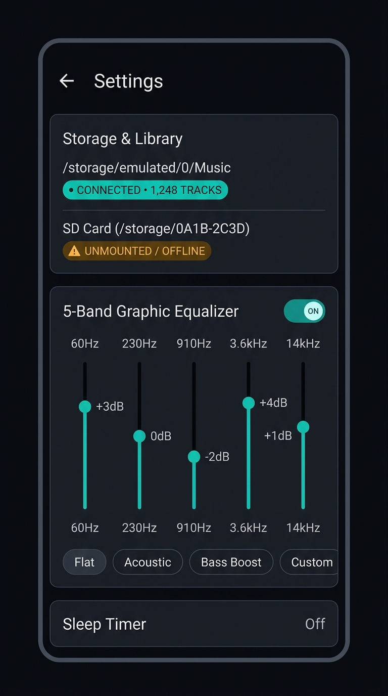

# Harmonia Mobile — Concept C: Settings, Storage & Equalizer (Stage 5C)

**Document Classification:** Visual Design Concept & Specification  
**Status:** DRAFT CONCEPT FOR REVIEW (Stage 5C)  
**Target Platform:** Android 14+ (Jetpack Compose, Android Audio Effects API, SAF Storage Lifecycle)  
**Target Form Factor:** Compact Mobile (390dp × 844dp to 412dp × 915dp, 9:16 / 19.5:9 aspect ratio)  

---

## 1. Visual Presentation & Concept Artifact

*Visual Render Description:* Concept C details the sovereign infrastructure and signal processing settings for Harmonia Mobile. It communicates transparent storage health (connected vs unmounted SD card volumes) and provides a tactile 5-band graphic equalizer.

---

## 2. Visual Hierarchy & Spatial Layout

Concept C organizes complex system capabilities into clean, high-contrast elevated cards:

1. **Top Navigation Bar (48dp height):**
   - Left: Back arrow button (48dp touch target).
   - Title: `Settings` in `displayLarge` (24sp bold, `#F0F3F8`).

2. **Storage & Local Library Card (160dp height):**
   - Elevated dark card (`#141721`) with 1dp hairline border (`#2A3042`) and 16dp rounded corners.
   - Header: `Storage & Library` in `titleLarge` (18sp semi-bold).
   - Primary Storage Mount:
     - Path: `/storage/emulated/0/Music` *(Illustrative sample directory path)* (`bodyLarge`, 15sp).
     - Status Badge: `CONNECTED • 1,248 TRACKS` in vibrant cyan-teal (`#00D2B4` text on `#003B33` container). *(Illustrative sample count)*.
   - Secondary Removable Storage (SD Card):
     - Path: `SD Card (/storage/0A1B-2C3D)` *(Illustrative sample volume)* (`bodyMedium`, 14sp).
     - Status Badge: `UNMOUNTED / OFFLINE` in amber warning pill (`#FFB020` on `#3D2800` container).
   - Distinguishes connected, unmounted, permission-revoked, and missing-file states honestly without generic errors.

3. **5-Band Graphic Equalizer Card (260dp height):**
   - Header row: `5-Band Graphic Equalizer` with master toggle switch (`ON`, active teal `#00D2B4`).
   - Vertical EQ Sliders (5 bands: 60Hz, 230Hz, 910Hz, 3.6kHz, 14kHz):
     > [!NOTE]
     > **Device-Dependent Frequencies & Presets:** The frequencies `60Hz, 230Hz, 910Hz, 3.6kHz, 14kHz` and presets `Flat, Acoustic, Bass Boost, Custom` shown in mockups are **illustrative sample data**. In the actual implementation, band count, center frequencies, min/max millibel ranges, and factory preset names are queried dynamically from the underlying Android platform HAL via `EqualizerBand` and `EqualizerPreset` (`[VERIFIED-SRC]`).
     - Sliders feature vertical cyan-teal progress tracks (`#00D2B4`) and tactile 16dp circular thumbs.
     - Gain labels dynamically displayed above thumbs: `+3dB`, `0dB`, `-2dB`, `+4dB`, `+1dB`. *(Illustrative sample gains)*.
     - Frequency labels below sliders: `60Hz`, `230Hz`, `910Hz`, `3.6kHz`, `14kHz` in tabular monospace (`#8E95A5`).
   - Preset Filter Chips (40dp height):
     - Horizontal row of pill chips: `Flat`, `Acoustic`, `Bass Boost`, `Custom`. *(Illustrative sample presets)*.
     - Selected chip has active cyan-teal border and background tint.

4. **Sleep Timer Row / Card (72dp height):**
   - Title: `Sleep Timer` in `titleMedium` (16sp, `#F0F3F8`).
   - Value / Status: `Off` (or `24 min remaining` when active, highlighted in teal).
   - Chevron indicating dialog or picker expansion.

---

## 3. Storage Lifecycle State Machine

Harmonia Mobile's UI explicitly communicates the exact physical state of user audio storage volumes:

| Physical Volume State | Visual Badge | Accent Color | User Guidance / Behavior | Source Verification |
| :--- | :--- | :--- | :--- | :--- |
| **Connected & Indexed** | `CONNECTED • N TRACKS` | Cyan-Teal (`#00D2B4`) | Normal playback; file is locally accessible. | `[VERIFIED-SRC]` (`StorageVolumeLifecycleCoordinator`) |
| **Unmounted / Removed** | `UNMOUNTED / OFFLINE` | Amber Warning (`#FFB020`) | Playback paused if currently playing; tracks grayed out with offline icon; no metadata deletion. | `[VERIFIED-SRC]` (`StorageVolumeLifecycleCoordinator`) |
| **Permission Revoked** | `PERMISSION REQUIRED` | Amber Warning (`#FFB020`) | Prompts user to re-grant SAF folder uri access. | `[VERIFIED-SRC]` (`SettingsScreen.kt`) |
| **Missing Specific File** | `FILE NOT FOUND` | Red Crimson (`#FF4B4B`) | Triggered if file was deleted externally; prompts re-scan. | `[VERIFIED-SRC]` (`LocalFileAvailability`) |

---

## 4. Equalizer Signal Architecture & Limitations

- **Engine Implementation:** Backed by Android platform `android.media.audiofx.Equalizer` attached to the active `ExoPlayer` audio session ID (`[VERIFIED-SRC]`, `HarmoniaPlaybackService`).
- **Hardware Honesty Rule:** Enabling the equalizer applies software-level biquad IIR filters in the Android audio pipeline. The UI **never claims** that enabling the equalizer maintains "bit-perfect" output, as DSP processing fundamentally modifies PCM samples.
- **Preemption Handling:** If another audio application or external USB DAC preempts audio effects control, the toggle displays an amber warning badge: `AUDIO EFFECT CONTROL PREEMPTED`.

---

## 5. Accessibility & Touch Targets

- **Vertical Slider Usability:** Each EQ vertical slider has a minimum touch bounding box of 48dp width × 180dp height, ensuring effortless manipulation without precise finger placement.
- **Preset Chips:** Minimum 48dp touch bounds with clear focus rings for D-pad/keyboard navigation.
- **High Contrast Text:** All status labels, frequency marks, and setting titles exceed WCAG AA contrast (5.95:1 to 17.70:1).
